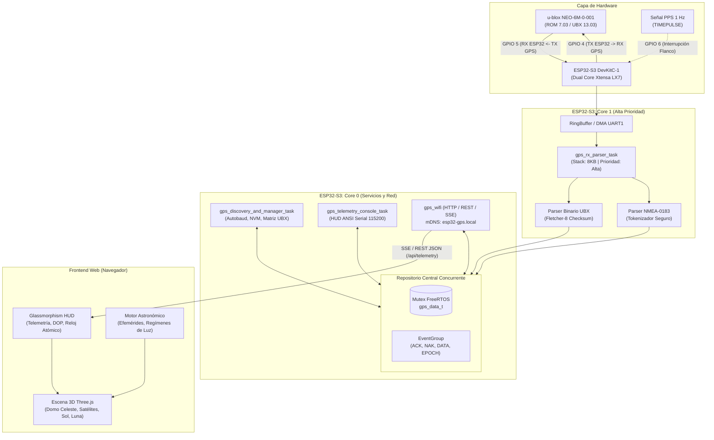

# 🛰️ ESP32-S3 u-blox NEO-6M GNSS Auditor & 3D Celestial Observatory

<div align="center">


<p align="center">
  <b>Sistema Integral de Firmware Concurrente, Auditoría de Protocolo UBX/NMEA y Observatorio Celeste 3D en Tiempo Real</b>
</p>

[Arquitectura](#-arquitectura-del-sistema) •
[Características](#-características-principales) •
[Conexión de Hardware](#-conexión-y-pinout) •
[Observatorio Web 3D](#-observatorio-web-3d) •
[Compilación y Despliegue](#-guía-de-compilación-y-despliegue) •
[API Telemetría](#-api-rest-y-streaming-sse)

---

</div>

## 📌 Descripción General

Este proyecto implementa una solución de ingeniería de firmware de alto rendimiento para el microcontrolador **ESP32-S3** (arquitectura Xtensa LX7 dual-core) emparejado con un receptor GNSS **u-blox NEO-6M-0-001** (ROM 7.03 / UBX Protocol 13.03 en placa *GY-NEO6MV2* / *GY-GPS6MV2*).

El sistema no solo procesa tramas NMEA estándar, sino que ejecuta una **auditoría profunda del silicio u-blox**, negociando velocidades dinámicas mediante el protocolo binario **UBX**, caracterizando la persistencia en memoria no volátil (NVM / EEPROM / BBR), supervisando la decodificación de efemérides y sirviendo una interfaz visual tridimensional en tiempo real con modelado astronómico y cálculo orbital.

---

## ⚡ Características Principales

### 🔬 1. Núcleo de Firmware y Auditoría UBX (ESP-IDF / FreeRTOS)
- **Ejecución Asimétrica Dual-Core**: Aislamiento estricto de la capa de interrupción/lectura UART a alta frecuencia en **Core 1** y la pila de red WiFi / HTTP / mDNS / Consola en **Core 0**.
- **Autobauding Determinista**: Barrido automático y sincronización desde la velocidad por defecto de ROM (9600 bps) hasta alta velocidad (115200 bps) mediante comandos `UBX-CFG-PRT`.
- **Validador Fletcher-8 Checksum**: Verificación de integridad matemática por hardware/software de todas las tramas binarias UBX y autodiagnóstico en arranque.
- **Matriz de Capacidades y Pruebas Negativas**: Auditoría de clases completas (`NAV`, `RXM`, `MON`, `TIM`, `AID`, `CFG`, `INF`) con gestión determinista de respuestas `ACK-ACK`, `ACK-NAK` y tiempos límite.
- **Motor de Confianza y Calentamiento (Warmup & Trust Engine)**:
  - Detección de arranque en frío (*Cold Start*), recepción de almanaque y decodificación de efemérides ($C/N_0 \ge 27\text{ dB-Hz}$).
  - Certificación estricta de época basada en umbrales de precisión: $\text{PDOP} < 6.0$, $\text{hAcc} < 10\text{ m}$, $\text{tAcc} < 1000\text{ ns}$ y mínimo de 4 satélites con solución 3D.
  - Lógica adaptativa de SBAS (deshabilitación automática fuera de huella WAAS/EGNOS/MSAS para priorizar el modelo ionosférico Klobuchar).
- **Consola Interactiva ANSI estructurada**: Monitor serie a 115200 bps con visualización gráfica en vivo de relación señal-ruido por canal, constelación en vista, vector cinemático y estado de enlace.

### 🌐 2. Observatorio Celeste 3D y Telemetría Web
- **Motor WebGL Three.js**: Esfera celeste en tiempo real con renderizado de la constelación de satélites GPS/SBAS georreferenciados según Acimut y Elevación.
- **Modos de Cámara Múltiples**:
  - `Órbita 3D`: Navegación espacial libre alrededor de la estación base.
  - `Ojo de Pez Cenital (Suelo → Cenit)`: Vista proyectada desde la perspectiva del receptor hacia el cielo.
  - `Domo Polar Acimutal (Cenit ↓)`: Proyección clásica de cielo polar (Skyplot).
- **Cálculo Astronómico Integrado (`astronomy.js`)**: Posicionamiento astronómico en tiempo real del Sol y la Luna, cálculo de fases lunares y regímenes crepusculares (Día Solar, Crepúsculo Civil, Náutico, Astronómico y Noche).
- **Inspección Interactiva por Raycasting**: Tooltips flotantes con detalle canal por canal: PRN, elevación, acimut, relación portadora-ruido ($C/N_0$ en dB-Hz), desplazamiento Doppler estimado y estado de efemérides.
- **Streaming en Tiempo Real**: Servidor HTTP en chip que expone eventos en servidor (*Server-Sent Events* - SSE) y endpoints REST para sincronización milimétrica con el reloj atómico.

---

## 🏛 Arquitectura del Sistema



---

## 🔌 Conexión y Pinout

> [!IMPORTANT]
> **Restricción Estricta de Pines**: El firmware está configurado para operar exclusivamente en los pines especificados a continuación. No se utilizan otros pines del ESP32-S3 para el subsistema GPS.

| Señal ESP32-S3 | Pin Físico | Dirección | Pin u-blox NEO-6M | Función / Descripción |
| :--- | :---: | :---: | :---: | :--- |
| **`GPS_PIN_TX`** | **GPIO 4** | Salida | **RX** | Transmisión de comandos UBX / CFG / NMEA desde el ESP32-S3 |
| **`GPS_PIN_RX`** | **GPIO 5** | Entrada | **TX** | Recepción de tramas NMEA y respuestas UBX (*Pull-up interno activado*) |
| **`GPS_PIN_PPS`** | **GPIO 6** | Entrada | **PPS / TIMEPULSE** | Pulso por segundo de precisión atómica (*Pull-down interno, flanco de subida*) |
| **`3V3` / `5V`** | **3V3 / 5V** | Alimentación | **VCC** | Alimentación eléctrica del módulo receptor (según regulador de placa) |
| **`GND`** | **GND** | Masa | **GND** | Referencia de masa común |

---

## 💻 Monitor de Consola Serie ANSI

La consola serie conectada a la UART0 del ESP32-S3 (puente USB nativo a 115200 bps) presenta un panel enriquecido mediante secuencias de escape ANSI con redibujado en sitio:

```text
========================================================================================================
  AUDITOR u-blox NEO-6M-0-001  |  ESP32-S3 Dual-Core FreeRTOS  |  FW v2.0.0
========================================================================================================
  ENLACE: 115200 bps [BIDIRECCIONAL]  |  ESTADO: CONFIABLE CERTIFICADO (Epoca #703, Racha 250)
  RELOJ ATOMICO: 2026-11-09 15:57:03 UTC  |  LOCAL: 10:57:03 (UTC-5)  |  tAcc: 27 ns
--------------------------------------------------------------------------------------------------------
  [POSICION GEODESICA]
    Latitud:    +0.0000000°          hAcc:     2.500 m       ECEF X: +6378137.00 m
    Longitud:   +0.0000000°          vAcc:     3.800 m       ECEF Y:       +0.00 m
    Alt MSL:      15.000 m           pAcc:     4.500 m       ECEF Z:       +0.00 m
  [DILUCION DE PRECISION (DOP)]
    PDOP: 2.10 (Optimo)   HDOP: 1.20   VDOP: 1.70   TDOP: 1.10   GDOP: 2.40
  [CANALES & SENAL/RUIDO C/N0]
    CH 01 | PRN  4: [||||||||||||||||||||          ] 38 dB-Hz (Efemérides OK) -> NAVEGANDO
    CH 02 | PRN  9: [||||||||||||||||||||||        ] 42 dB-Hz (Efemérides OK) -> NAVEGANDO
    CH 03 | PRN 16: [||||||||||||                  ] 26 dB-Hz (Búsqueda)
    CH 04 | PRN 27: [||||||||||||||||              ] 32 dB-Hz (Efemérides OK) -> NAVEGANDO
========================================================================================================
```

---

## 🌌 Observatorio Web 3D

El directorio [`web/`](web/) contiene la aplicación web autónoma que puede servirse directamente desde el almacenamiento flash del ESP32-S3 o ejecutarse localmente con cualquier servidor estático:

1. **Esfera Celeste 3D con Three.js**:
   - Malla geodésica celeste con marcas de coordenadas horizontales (grados de acimut y elevación).
   - Marcadores orbitales para satélites en vista con identificación por código de colores según nivel de señal $C/N_0$.
   - Conos de visibilidad y vectores hacia el cenit.
2. **Cuerpo Celeste Solar y Lunar**:
   - Posición analítica calculada mediante algoritmos astronómicos de alta precisión.
   - Determinación del ángulo de elevación solar para oscurecimiento atmosférico dinámico.
3. **HUD de Telemetría**:
   - Paneles laterales translúcidos con estilo *glassmorphism* que desglosan cinemática, dilución de precisión, incertidumbres cartesianas ECEF y diagnóstico del enlace microcontrolador-receptor.

---

## 📡 API REST y Streaming SSE

El servidor HTTP integrado en el ESP32-S3 expone los siguientes endpoints:

| Endpoint | Método | Formato | Descripción |
| :--- | :---: | :---: | :--- |
| `/api/telemetry` | `GET` | `application/json` | Devuelve la instantánea completa de telemetría de la última época consolidada. |
| `/api/stream` | `GET` | `text/event-stream` | Flujo Server-Sent Events (SSE) con emisión periódica (1 Hz) de la época GNSS. |
| `/api/capabilities` | `GET` | `application/json` | Matriz de resultados de la auditoría de comandos y clases UBX. |
| `/` | `GET` | `text/html` | Interfaz web del Observatorio Celeste 3D embebida. |

### Ejemplo de Carga JSON de Telemetría:
```json
{
  "seq": 703,
  "trusted": true,
  "lat": 0.0000000,
  "lon": 0.0000000,
  "hMSL": 15.000,
  "hAcc": 2.500,
  "vAcc": 3.800,
  "pAcc": 4.500,
  "gSpeed": 0.170,
  "heading": 0.40,
  "dop": {
    "gdop": 2.40,
    "pdop": 2.10,
    "hdop": 1.20,
    "vdop": 1.70,
    "tdop": 1.10
  },
  "time": {
    "utc": "2026-11-09 15:57:03Z",
    "local": "2026-11-09 10:57:03",
    "tAcc_ns": 27
  },
  "satellites": [
    {"prn": 4, "elev": 45, "azim": 120, "cno": 38, "used": true},
    {"prn": 9, "elev": 68, "azim": 210, "cno": 42, "used": true}
  ]
}
```

---

## 🛠 Guía de Compilación y Despliegue

### Requisitos Previos
- [PlatformIO Core](https://platformio.org/) o extensión oficial en [Visual Studio Code](https://code.visualstudio.com/).
- Cadena de herramientas para ESP-IDF (`espressif32@^6.9.0`).
- Cable USB conectado al puerto COM del **ESP32-S3 DevKitC-1**.

### Configuración de Red Wi-Fi
Edite [`src/gps_config.h`](src/gps_config.h) con los parámetros de su red inalámbrica local:

```c
#define GPS_WIFI_STA_SSID         "SU_NOMBRE_DE_RED"
#define GPS_WIFI_STA_PASS         "SU_CONTRASEÑA"
#define GPS_MDNS_HOSTNAME         "esp32-gps"
```

### Compilar y Grabar Firmware
```bash
# Compilación del proyecto
pio run

# Carga del binario al ESP32-S3
pio run --target upload

# Abrir el monitor serie estructurado a 115200 bps
pio device monitor -b 115200
```

---

## 📂 Estructura del Repositorio

```text
├── .gitignore                    # Filtros de exclusión para compilación y temporales
├── CMakeLists.txt                # Configuración raíz de compilación ESP-IDF
├── platformio.ini                # Definición de entorno, flags y librerías PlatformIO
├── sdkconfig.defaults            # Configuración base del SDK (newlib float printf, etc.)
├── sdkconfig.esp32-s3-devkitc-1  # Configuración detallada para el módulo ESP32-S3
├── src/                          # Código fuente del firmware en C
│   ├── CMakeLists.txt            # Reglas de construcción y flags de compilación estrictos
│   ├── gps_config.h              # Parámetros globales, pines (GPIO 4/5/6) y tiempos
│   ├── gps_hw.h / .c             # Controlador de bajo nivel UART1 e interrupción PPS
│   ├── gps_data.h / .c           # Repositorio de datos con protección de Mutex FreeRTOS
│   ├── gps_discovery.h / .c      # Máquina de estados: autobaud, auditoría UBX y persistencia
│   ├── gps_warmup.h / .c         # Evaluación de efemérides y métricas de confianza
│   ├── gps_console.h / .c        # Interfaz de telemetría ANSI en consola serie
│   ├── gps_wifi.h / .c           # Pila Wi-Fi STA, mDNS y servidor HTTP/SSE
│   ├── nmea_parser.h / .c        # Parser seguro de tramas NMEA-0183
│   ├── ubx_defs.h                # Definición exhaustiva de estructuras y opcodes UBX
│   ├── ubx_protocol.h / .c       # Codificador/Decodificador binario y checksum Fletcher-8
│   └── main.c                    # Punto de entrada app_main() y orquestación de tareas
└── web/                          # Interfaz web del Observatorio 3D
    ├── index.html                # Estructura del visor WebGL y HUD glassmorphism
    ├── css/
    │   └── main.css              # Estilos, efectos de desenfoque y diseño responsivo
    └── js/
        ├── app.js                # Controlador principal de telemetría y conexión
        ├── astronomy.js          # Algoritmos astronómicos de posicionamiento solar y lunar
        └── scene3d.js            # Motor de renderizado 3D con Three.js y proyección cenital
```

---

## 📄 Licencia

Este proyecto se distribuye bajo la licencia **MIT**. Consulte el archivo de licencia para obtener más detalles.
